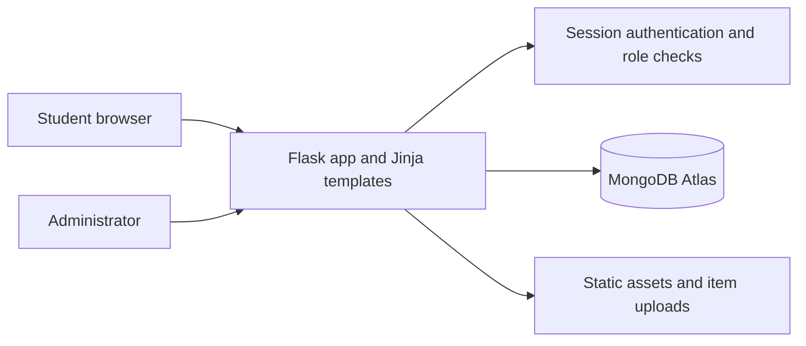

<div align="center">

# CampusLoop

### A campus marketplace built around reuse and trust.

Buy, sell, rent, and request the things students need, within one moderated community.

[Features](#features) · [Run locally](#run-locally) · [Deploy](#deploy-from-github) · [Architecture](#how-it-works)

</div>

CampusLoop is a full-stack Flask application backed by MongoDB. It brings campus listings, rentals, buyer and seller conversations, requests, and seller verification into one place. The project demonstrates authenticated workflows, role-based access, database-backed search, and moderation tools.

## Features

- **Accounts and roles:** registration, login, buyer and seller profiles, and a separately provisioned administrator role.
- **Trust and moderation:** admin-approved sellers, trust levels, account moderation, and listing review.
- **Marketplace:** searchable listings for sale or rent, item details, and order creation.
- **Campus requests:** rental requests and requests for items that are not currently listed.
- **Communication:** product-linked buyer and seller chat.
- **Admin tools:** seller verification, user moderation, and product management.

## How it works



**Stack:** Python · Flask · MongoDB Atlas · PyMongo · Jinja · HTML · CSS · JavaScript · Gunicorn

## Run locally

### Requirements

- Python 3.10 or newer
- A MongoDB database (MongoDB Atlas works)

### Setup

```bash
git clone https://github.com/swathy-1327/campusloop.git
cd campusloop
python -m venv .venv
```

Activate the virtual environment, then install dependencies and configure the environment:

```bash
# Windows PowerShell
.\.venv\Scripts\Activate.ps1
Copy-Item .env.example .env
python -m pip install -r requirements.txt
```

```bash
# macOS / Linux
source .venv/bin/activate
cp .env.example .env
python -m pip install -r requirements.txt
```

Edit `.env` with your MongoDB connection string and a unique session secret. You can generate a secret with:

```bash
python -c "import secrets; print(secrets.token_hex(32))"
```

Start the app:

```bash
python app.py
```

Open <http://127.0.0.1:5000>. The `/health` endpoint checks that the app can reach MongoDB.

### Create an administrator

New registrations always receive buyer access. Create an administrator from a trusted terminal connected to the same database:

```bash
flask --app app create-admin admin@example.com
```

The command prompts for a name, phone number, and password. If the email already has an account, it promotes that account without changing its password.

## Deploy from GitHub

GitHub Pages serves static files and cannot run this Flask and MongoDB application. This repository includes a Render Blueprint, so Render can build and deploy the Python app directly from the GitHub repository.

1. Push this repository to GitHub.
2. In Render, choose **New + → Blueprint**, connect this GitHub repository, and apply `render.yaml`.
3. In the Blueprint setup, provide `MONGO_URI` for a MongoDB Atlas database. Create a database user with a strong password and allow the Render service to connect in the Atlas network access settings.
4. Wait for the first deploy to finish, then open the generated `onrender.com` URL. Render creates `SECRET_KEY` for the service and sets secure session cookies.
5. Create the first administrator from a trusted terminal configured with the production database URI, using the command above.

The included GitHub Actions workflow checks that the application modules compile on pushes and pull requests. Render can redeploy automatically when changes are pushed to the connected branch.

**Uploads:** the demo stores uploaded images on the app filesystem. On free hosted instances, local files may be temporary and can disappear after a restart or deploy. For durable production uploads, connect object storage and configure `UPLOAD_FOLDER` or replace the local upload handler with a storage service.

## Security notes

- Keep `.env`, database credentials, and production secrets out of Git. Configure them as environment variables in the hosting provider.
- Do not run `seed_demo.py` against a production database. It is intended only for a disposable demo database.
- Admin access is created explicitly from a trusted terminal; public sign-up cannot grant it.
- This is a portfolio/demo application. Add email verification, CSRF protection, rate limiting, and managed image storage before handling real users or transactions.

## Resume summary

**CampusLoop — Full-stack campus marketplace** · Python, Flask, MongoDB, Jinja

Built a campus reuse platform with role-based accounts, admin-approved sellers, trust scoring, searchable sale and rental listings, order workflows, item requests, and buyer/seller chat. Added a GitHub Actions compile check and a one-click Render Blueprint for deployment.

## License

No license is currently provided. Add a license file before inviting others to reuse or redistribute this project.
